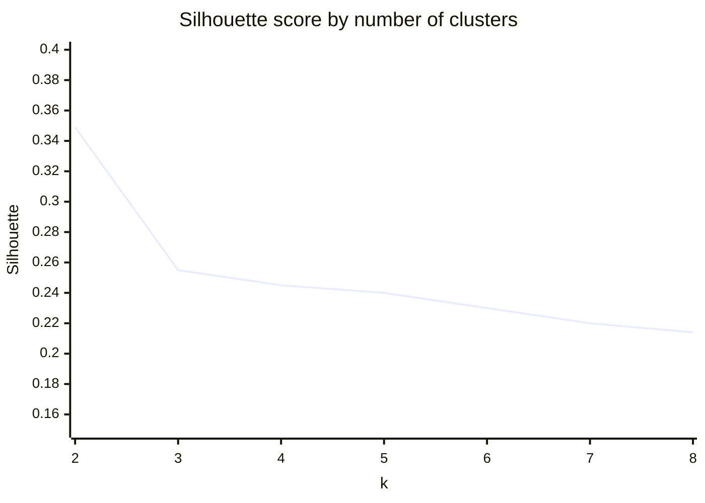
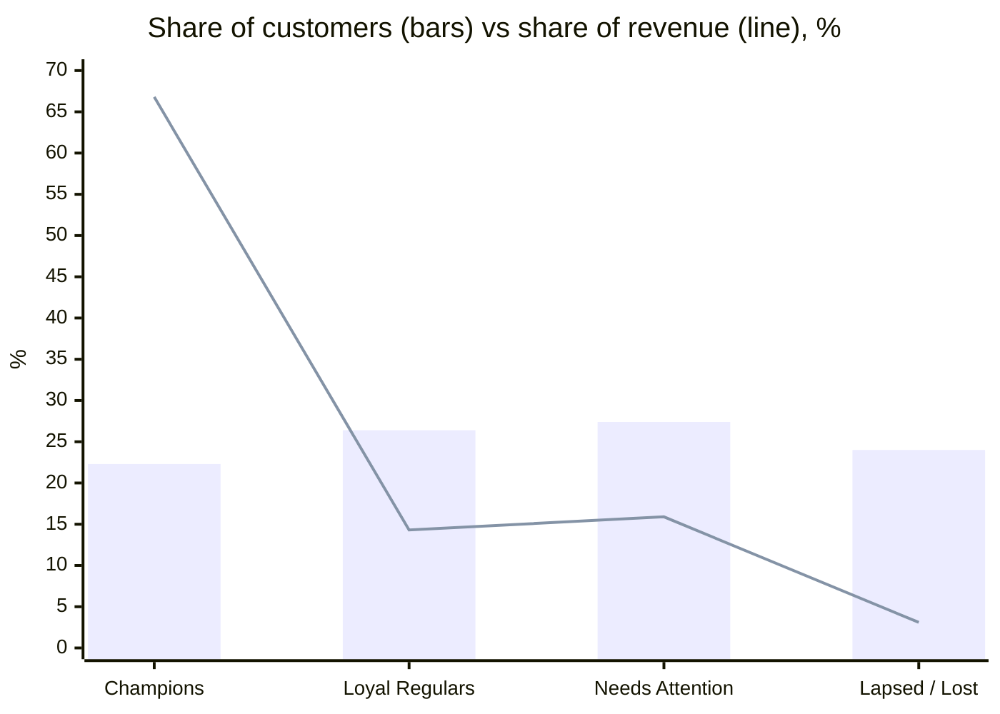

# Customer Segmentation with RFM + K-Means

Segments the customers of an online retailer by purchase behaviour so marketing can treat each group differently. Each segment comes with a concrete action.

**Data:** UCI Online Retail, a UK online gift retailer, Dec 2010 to Dec 2011. After cleaning there are **396,470 transactions from 4,334 customers**. The script downloads the data automatically.
**Stack:** Python, pandas, scikit-learn (K-Means, PCA, silhouette), matplotlib

## Approach

1. **Clean the data.** Remove cancellations (`C` invoices), rows with no customer ID, non-positive quantities or prices, and postage or fee lines. That takes 541,909 rows down to 396,470.
2. **Build features per customer:**
   - Recency, Frequency, Monetary (RFM).
   - Average order value.
   - Number of distinct products bought.
3. **Transform.** Apply a log transform and standard scaling, because spend is heavily right-skewed. The top 0.5% of wholesale-scale spenders (22 customers) are excluded from clustering and handled as key accounts.
4. **Choose k.** I used the elbow and silhouette scores.
   - Silhouette peaks at k=2 (0.35), but two groups are just "good" and "bad", which marketing can't act on.
   - **k=4** (silhouette 0.245) gives distinct segments that each have an action.



## Segments

| Segment | Customers | Median recency (days) | Median orders | Median spend | Revenue share | Action |
|---|---|---|---|---|---|---|
| **Champions** | 962 (22%) | 14 | 8 | £3,087 | **67%** | VIP perks, early access, referrals. Protect them; don't discount. |
| **Loyal Regulars** | 1,137 (26%) | 23 | 3 | £745 | 14% | Cross-sell bundles and loyalty points to move them up a tier. |
| **Needs Attention** | 1,180 (27%) | 122 | 1 | £609 | 16% | Personalised win-back email within 30 days, with a time-limited offer. |
| **Lapsed / Lost** | 1,033 (24%) | 152 | 1 | £172 | 3% | Low-cost reactivation only; leave them out of paid channels. |

**Key insight:** **22% of customers generate 67% of revenue**. Losing a few Champions costs more than reactivating all Lapsed customers combined. "Needs Attention" customers place large single orders (median AOV £403, as high as Champions) but haven't come back in about 4 months, so they're the best win-back target.



The script also saves a PCA scatter of the segments and the PNG versions of these charts to `results/`.

## Run it

```bash
pip install -r requirements.txt
python segment.py    # writes charts and CSVs to results/
```

*Author: [Taha Su](https://www.linkedin.com/in/tahasu)*
